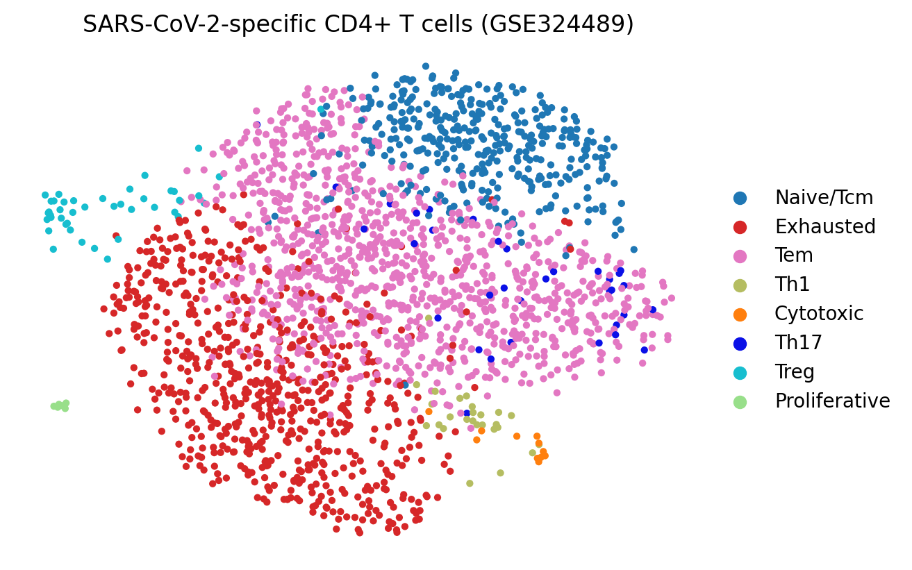

# I1: Reproduce the CD4 T-cell phenotype UMAP

Date: 2026-10-13

## Question

Can the processed single-cell dataset from GSE324489 be used to reproduce a UMAP of the
phenotypic states of SARS-CoV-2-specific CD4+ T cells?

This is a **reproduction of the published visualization** using the authors' processed data,
UMAP coordinates and phenotype annotations. It is not an independent reanalysis from raw reads.

## Status

**Not yet run.** The environment where this log was prepared had no access to GEO/NCBI, so the
data were not downloaded and no figure or counts have been produced. The numbers and image
below must be filled in after running the script.

## Method

1. Download the processed SARS-CoV-2 `.h5ad` file from the GSE324489 supplementary files
   (https://www.ncbi.nlm.nih.gov/geo/query/acc.cgi?acc=GSE324489).
2. Install dependencies: `pip install scanpy matplotlib`.
3. Run: `python experiments/scripts/i1_cd4_t_cell_umap.py <file.h5ad>`
   The script prints `obs` columns and `obsm` keys, picks the stored UMAP and a candidate
   phenotype column, prints per-phenotype counts, and saves
   `experiments/figures/i1_cd4_t_cell_umap.png`.
4. Confirm the chosen column is the published phenotype annotation (paper phenotypes: naive/central
   memory, effector memory, Th1, Treg, Th17, cytotoxic, exhausted, proliferating) and edit the
   script if another column is correct.

## Results

- Dataset file name: _TODO_
- Number of cells: _TODO_
- Phenotype column: _TODO_
- UMAP key in `obsm`: _TODO_

| Phenotype | Cells |
| --------- | ----- |
| _TODO_    | _TODO_ |

Figure (add after running):

## Conclusion

_TODO after running._
