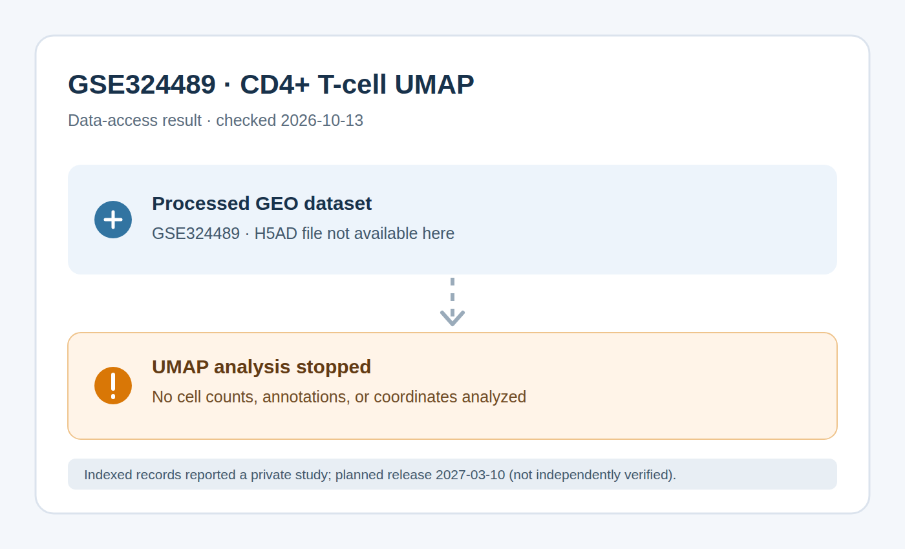

# Visualizing SARS-CoV-2-Specific CD4+ T-Cell Phenotypes with UMAP

2026-10-13

<a href="https://github.com/emd5-afk/tfcb_2026/issues/1">GitHub Issue emd5-afk/tfcb_2026#1</a>

## Reagents

This was a computational experiment; no physical reagents were used. The
processed dataset was not available, so no single-cell analysis software was
installed or run.

| reagent | vendor | catalog number | stock concentration | final concentration |
|---|---|---|---|---|
| GSE324489 study record (dataset unavailable) | NCBI GEO | GSE324489 | N/A | N/A |
| Python | Python Software Foundation | 3.12.3 | N/A | N/A |
| curl | curl project | 8.5.0 | N/A | N/A |
| Git | Git project | 2.55.0 | N/A | N/A |
| Chromium (status-figure rendering) | Chromium project | 154.0.8037.0 | N/A | N/A |

## Procedure

No liquid volume or experimental temperature applies because no physical sample
was handled.

1. Searched the repository for a `.h5ad` dataset; none was present. Search
   runtime: 0.00 seconds.
2. Checked the Python environment (Python 3.12.3); `scanpy`, `anndata`,
   `pandas`, and `matplotlib` were not installed. Environment-check runtime:
   approximately 0.01 seconds.
3. Requested the GSE324489 GEO page with `curl` 8.5.0. The request failed with
   a DNS resolution error (HTTP status 000); runtime: 0.01 seconds.
4. Checked public indexed records for the accession. They reported that the
   study was private and scheduled for release on 2027-03-10; the direct NCBI
   page could not be independently verified from this environment. Search
   runtime was not captured.
5. Stopped the analysis without loading data, calculating cell counts, or
   recomputing UMAP coordinates because the input dataset was unavailable.
   Volume, runtime, and temperature: not applicable/not measured.
6. Rendered a data-access status diagram, not a UMAP, with Chromium 154.0.8037.0
   and saved it as
   `experiments/img/2026-10-13_cd4_t_cell_umap.png`. Rendering runtime:
   20.24 seconds.

## Result

Figure 1. Status of the GSE324489 data-access check on 2026-10-13; this is not
a UMAP and contains no cell-level data. Diagram produced by the Copilot coding
agent.

No cells, phenotype categories, counts, or percentages could be reported. The
required UMAP cannot be generated until the processed dataset is publicly
available and accessible.

## Interpretation

This experiment did not produce a biological result. The status diagram records
why the requested visualization could not be reproduced; it must not be
interpreted as a UMAP or as evidence about CD4+ T-cell phenotypes.

## Limitations

The processed GSE324489 dataset could not be retrieved, and the GEO page could
not be reached from this environment because DNS resolution failed. Search
results reported a future public release date, but that status was not
independently confirmed on the NCBI page. No expression matrix, annotations, or
stored UMAP coordinates were inspected, so no biological conclusions can be
drawn. Replace the status image with the UMAP and update the results after the
dataset becomes accessible.

## Data source

Zhang R. et al. “Whole-protein screening and multi-modal profiling of
antigen-specific CD4+ T cells at single-cell resolution.” *Nature
Communications*, 2026.

GEO accession [GSE324489](https://www.ncbi.nlm.nih.gov/geo/query/acc.cgi?acc=GSE324489).
